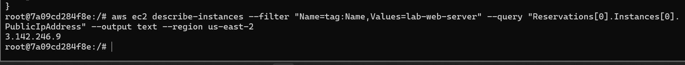
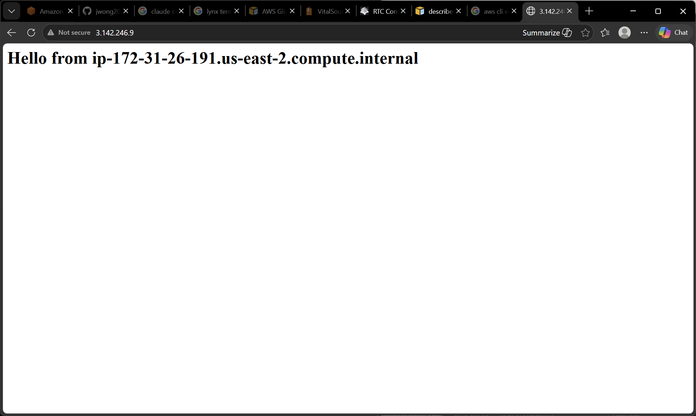
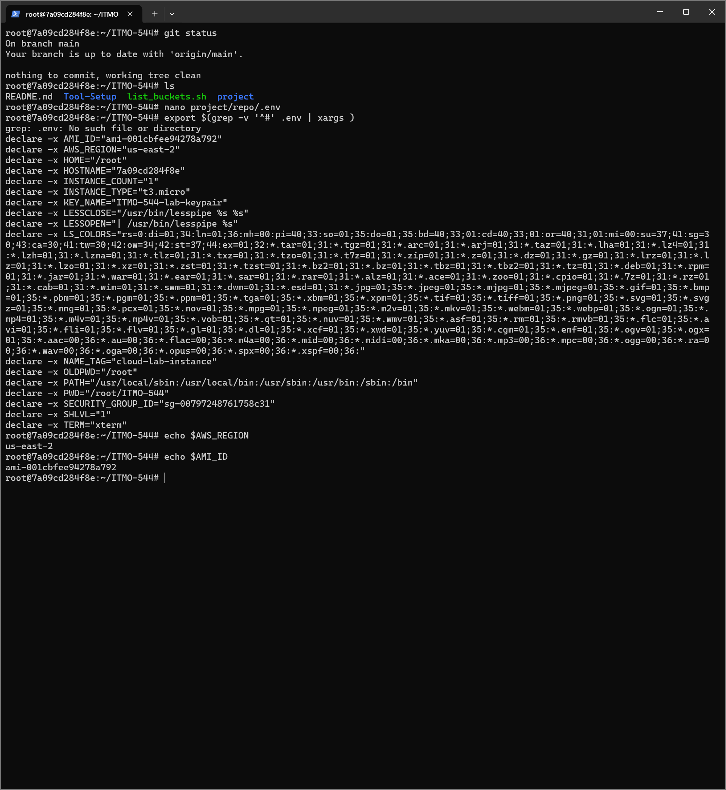
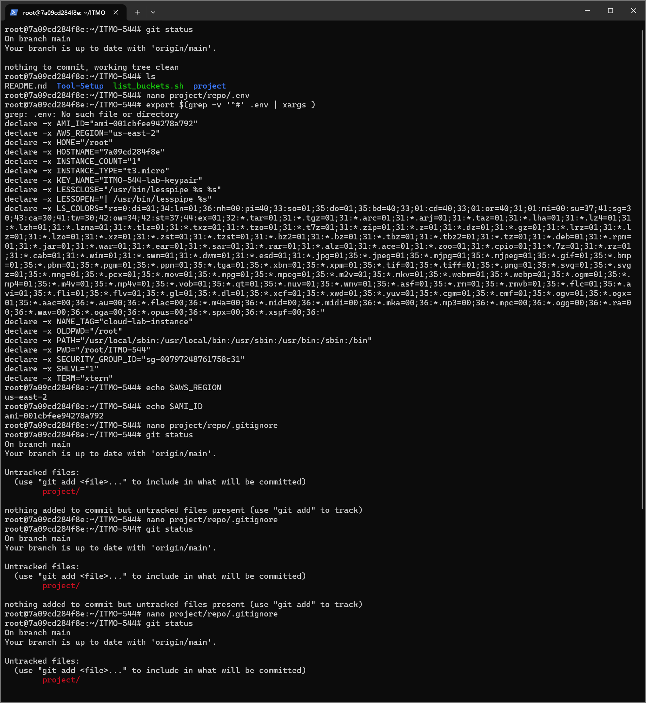
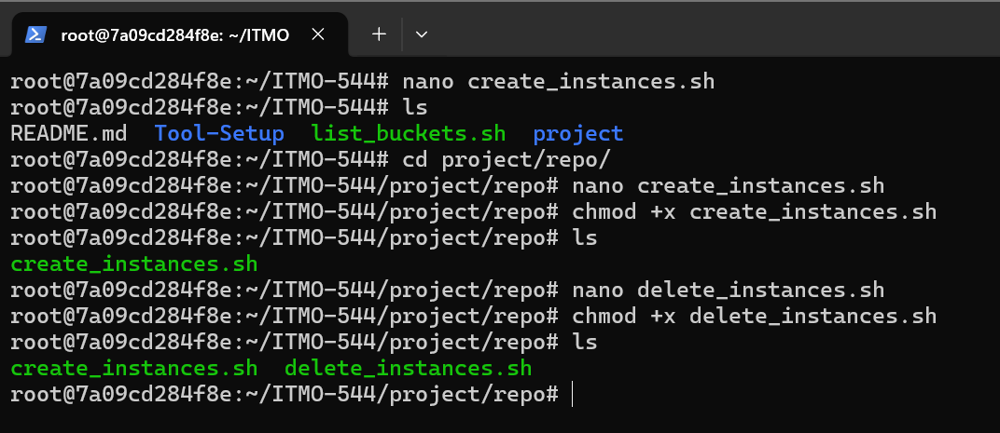
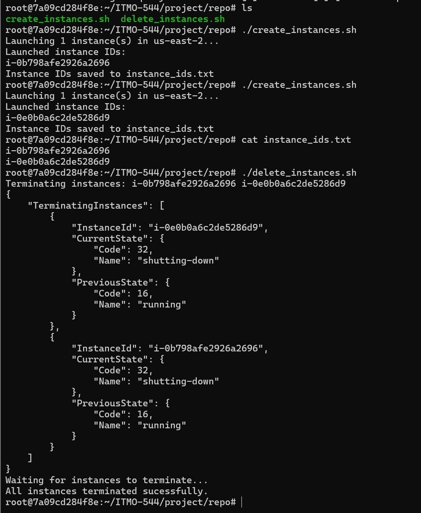
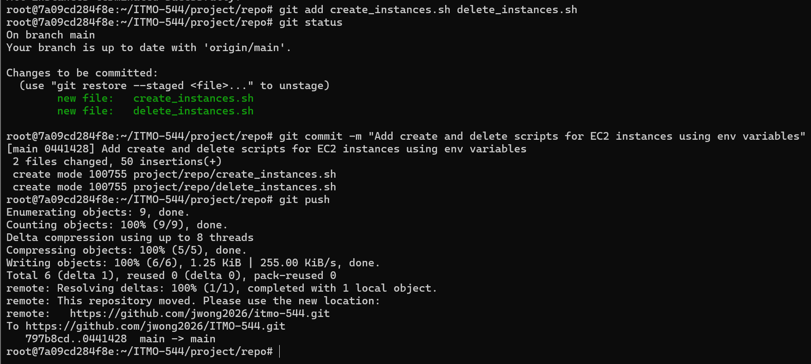

Jimmy Wong
September 10, 2026
ITMO-544
Lab 02 - AWS CLI EC2 Environment Variables

Note: this is my first time creating a MD file. 

## Part B
### B1. Find a Free-Tier-Eligible AMI

The picture above shows I searched for free tier upgrade only via filters to receive an “image-id” to create an instance. 
- Service: "aws ec2", to select a service that will be used to run in a command line. 
- Operation: "describe-images", to select an operation along with the service to tell what a command line needs to do. 
- Parameters: 
  - "--owners": to identify who owns image(s) such as AWS, Microsoft, Apple, etc. 
  - "--filters": to filter what input options you need to look for.
  - "--query": to sort by which specific field you want to read. 
  - "--output": to print an output in a formatting style. 
  - "--region": to select a region option. USA currently have 4 regions (two in West Coast and other two in East Coast). 

## Part C
### C5. Verify and Test

The picture above shows that I created an instance to deploy a web server to display “hello”. I used the public IP address from the picture above. 

The picture above shows that the web server is working properly and publicly. 

## Part D
### D1-2. Create the .env File & Load the .env File into your Shell

### D3. Protect the .env file with .gitignore

The picture above shows that the .gitignore file will exclude any files you don’t want to be pushed to a repository. With .gitignore, .env file will not be included in commit and push commands. 

## Part E
### E1-2. create_instances.sh and delete_instances.sh

The picture above shows that I created two scripts to create and delete instances whenever I need to run via CLI. 
(Note: I noticed professor’s script on the lab instruction says “>” which is only write or overwrite an existing file. So I changed the “>” to “>>” to make sure the data is being added to the file instead of being overwritten.)

### E3. Run the Full Cycle

The picture above shows I ran both scripts to ensure both scripts are doing their jobs properly. 

### E4. Commit your Scripts (Not Your .Env!)

The picture above shows that both scripts are committed and pushed to my repository. The .env file is excluded from the commit and push. 

## Link to where the create_instances.sh, delete_instances.sh, .env.example, and .gitignore (but not .env)
Link: [Saved Location](https://github.com/jwong2026/itmo-544/tree/main/project/repo).

## Question
**One paragraph explaining why environment files are excluded from Git, even in a "private" repository.**
Environment files contain sensitive information. The sensitive information could have passwords, encryption keys, configurations, etc. like a pandora's box. 
They are not designed to share on Internet as known as "public". 
If .env files are uploaded in a private repository, they would not be safe anymore because the private repository is on Internet and a hacker could breach GitHub that stores millions of repositories by developers. Even if you deleted .env files on the repository, GitHub still have stored them in a repository place where it has a past history of versions and that allows developers to pull from a targeted past version. 
