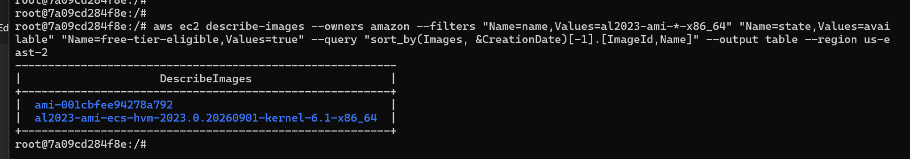

Jimmy Wong
September 10, 2026
ITMO-544
Lab 02 - AWS CLI EC2 Environment Variables

Note: this is my first time creating a MD file. 

## Part B
B1. Find a Free-Tier-Eligible AMI

## Part C
C5. Verify and Test
?

## Part D
D3. Protect the .env file with .gitignore
?

## Part E
E1. ?
?

E2. ?
?

E3. Run the Full Cycle
?

E4. Commit your Scripts (Not Your .Env!)
?

## Question
**One paragraph explaining why environment files are excluded from Git, even in a "private" repository.**
?
