Jimmy Wong\
October 13, 2026\
ITMO-544\
Lab 04 - Multi-AZ Resilience: ALB, Auto Scaling, Groups, and Recovery-Time SLOs

# Part B -- ALB Security Group and Tightening the App Security Group
Question: You can explain, in one sentence, why *--source-group* is a tighter rule than *--cidr 0.0.0.0/0*, even though both currently let traffic on port 3000 through.\
Answer: The *--cidr 0.0.0.0/0* is to expose to public internet that is allowed to access via the port 3000. The *--source-group* is created to tighten the security to not let anyone else than application security group created and assigned to Application Load Balance (ALB) that will act as "front" to not let the uploader/viewer expose their own IP addresses, and in this case the ALB is exposed to the public internet via the port 8080 and 8081. 

# Part C -- Target Groups, Load Balancer, and Listeners
Question: You can explain, in one sentence, the difference between a target group and a listener.\
Answer: a listener is a port that forwards incoming traffic to an IP address while a target group is the specific set of instances or targets that the ALB actually health-checks and routes incoming traffics to. 

# Part D -- Auto Scaling Groups: The Recovery Mechanism
Question: You can explain, in one sentence, why *--health-check-type ELB* matters more here than it would for a single standalone instance.\
Answer: The *--health-check-type ELB* matters more is because it forces ASG to replace an instance if an application failed to get health check.

# Part E -- Extend Your Create and Delete Scripts
Question: You can point to the exact line in *create_app_stack.sh* where the old run-instances call used to be, and explain what replaced it.\
Answer: "***echo "== Launching instances from the templates =="***" is where this used to run *run-instances* the launch templates. This line is replaced with ASG commands to make a better version of how humans do not need to interact with AWS. 

# Part G -- Run the Experiment
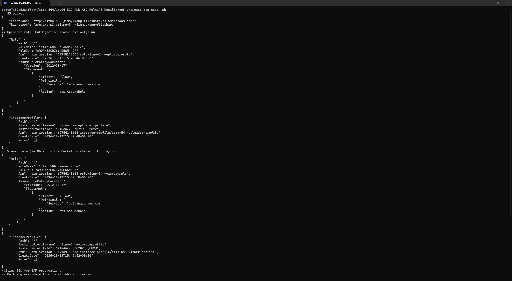
The picture above shows the create_app_stack.sh is being executed. In this picture, first lines are from the previous lab, lab 03.

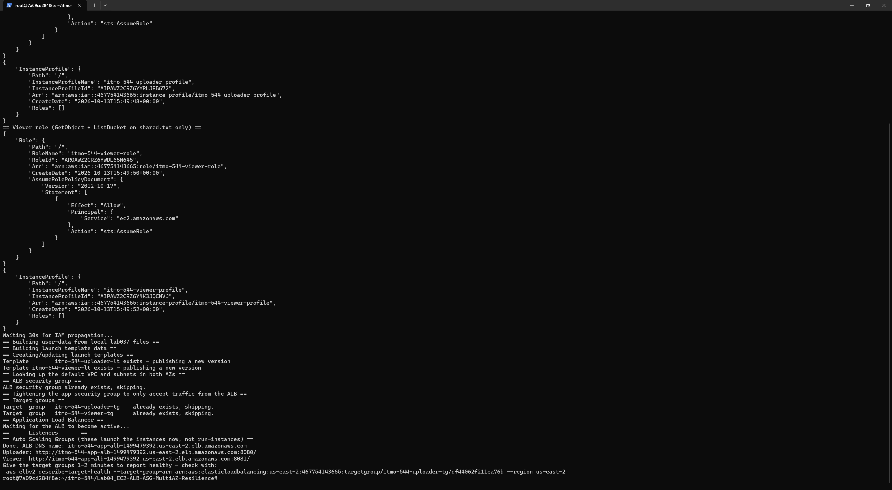
The picture above shows the create_app_stack.sh is being executed. In this picture, new lines from the lab 04 instruction to focus on application load balance and auto scaling group. 

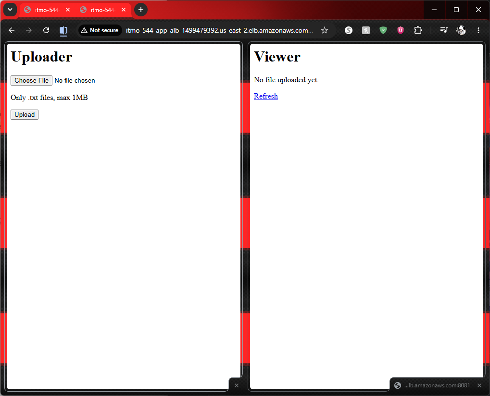
The picture above shows the uploader and viewer pages are showing success properly along with the DNS. 

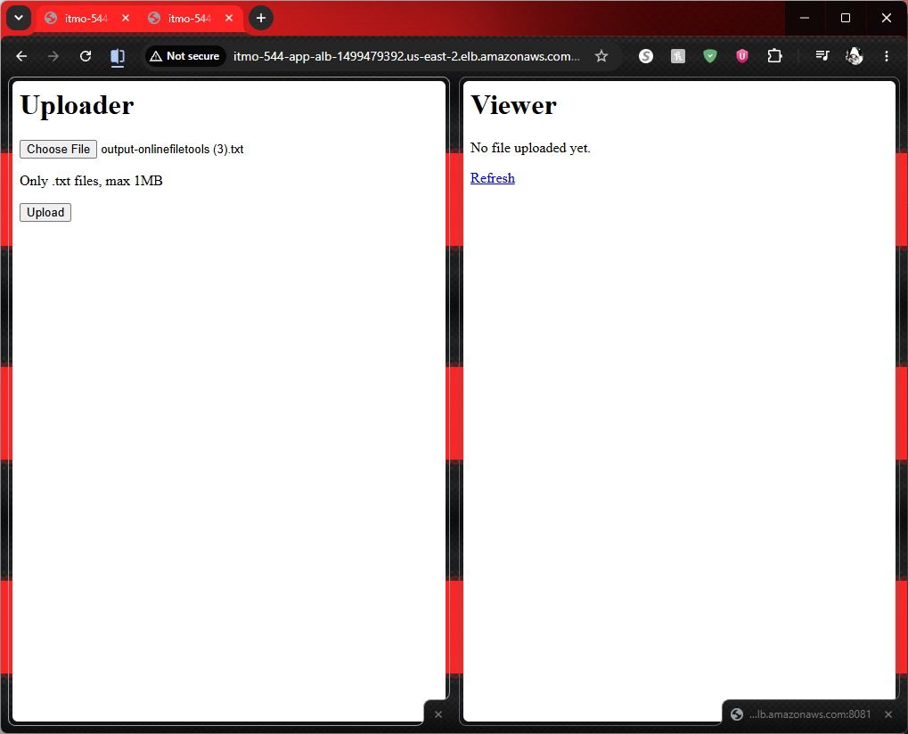
The picture above shows the txt file is being attached/uploaded to the uploader web.

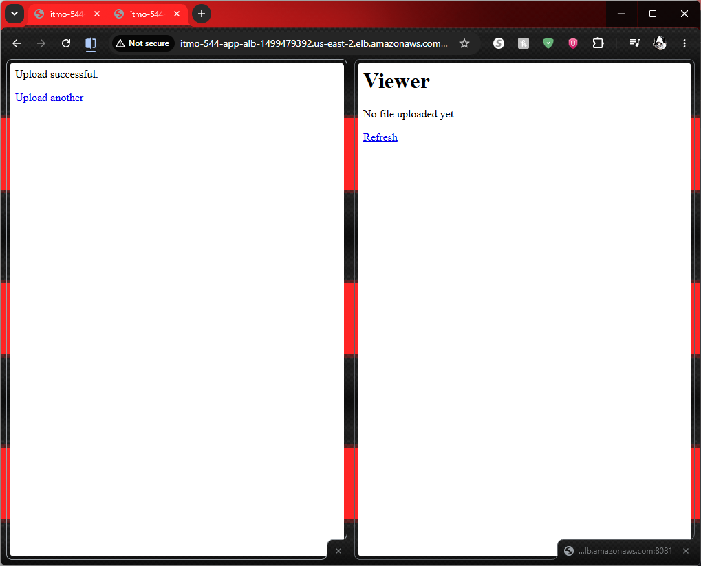
The picture above shows the txt file is uploaded successfully. 

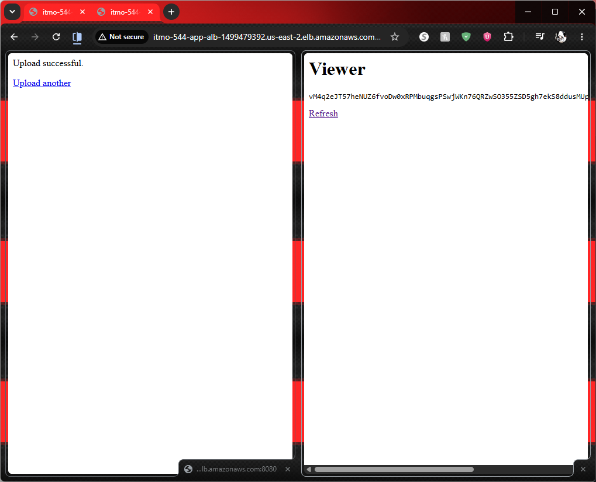
The picture above shows the viewer is able to read the txt file that is uploaded from the uploader web.

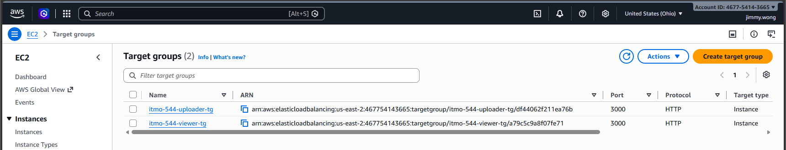
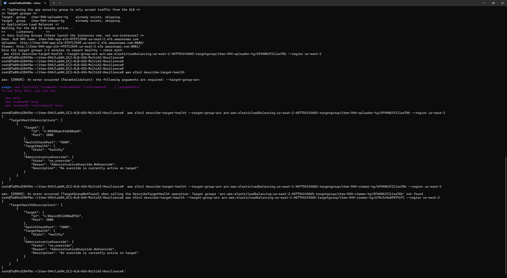
The picture above shows the *aws elbv2 describe-target-health* command is being shown that both target groups are healthy.

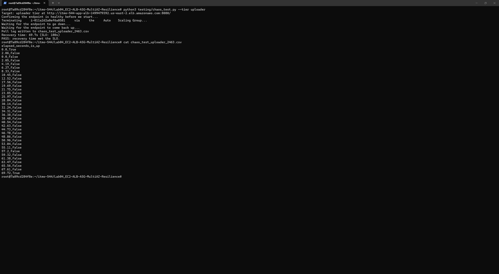
The picture above shows the chaos-test.py for uploader is executed and made an output in .csv file.\
URL to .csv file: [Chaos Test Uploader PASS in CSV file](chaos_test_uploader_2463.csv)

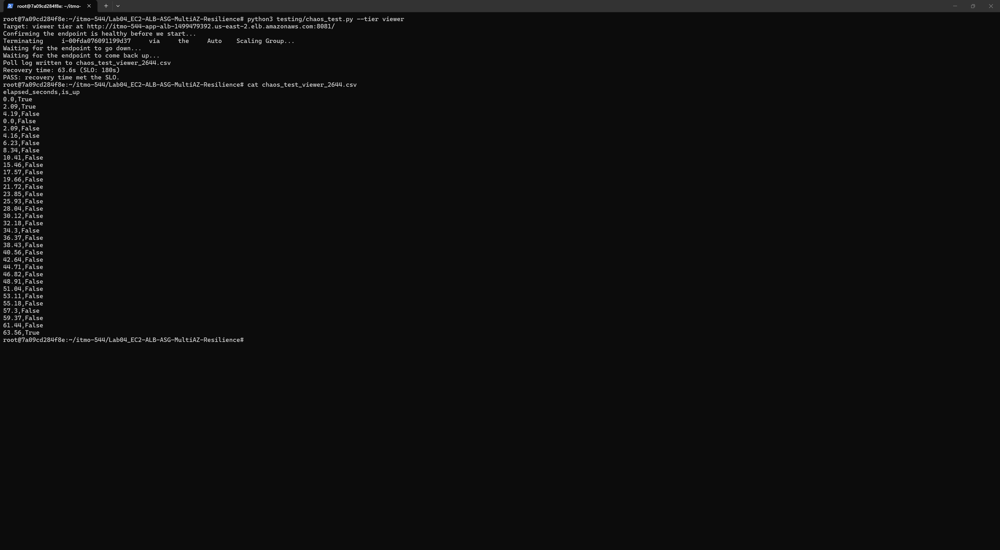
The picture above shows the chaos-test.py for viewer is executed and made an output in .csv file.\
URL to .csv file: [Chaos Test Viewer PASS in CSV file](chaos_test_viewer_2644.csv)

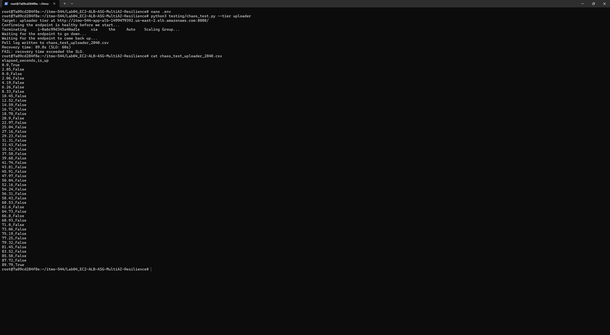
The picture above shows the chaos-test.py for uploader is executed and made an output in .csv file.\ 
One thing is changed in this picture is to change the "*RECOVERY_SLO_SECONDS*" from 180 seconds to 60 seconds to tighten the timer.\
URL to .csv file: [Chaos Test Uploader PASS in CSV file](chaos_test_uploader_2840.csv)

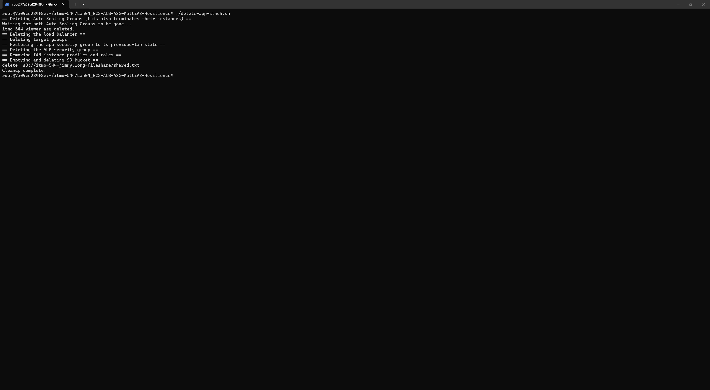
The picture above shows the delete_app_stack.sh is being executed properly before any of those services start charging credits. 

# Q & A
Question: One paragraph explaining, using your own recovery-time numbers, what dominates the recovery window (health-check timing vs. boot/npm install time vs. something else).\
Answer:
- The instance boot and npm install application initialization time are what dominate the recovery window. Both bootup and installation take time to finish up before their application becomes available to public while ALB does health-checks on instances' status (unhealthy or healthy). While the ALB monitoring health-checks on unhealthy instance, the transition from unhealthy (old instance to replace) to healthy (new after replacing the old instance) takes some time. In all .csv files for PASS, the recovery SLO time is 180 seconds which is 3 minutes to allow ASG to detect health-checks then replace instances if unhealthy is discovered. Between old instance and new instance, the new instance is deployed immediately but at the same time, it needs to boot up and do npm install application which consumes a bit longer time before the new instance can take over the old instance and run without any client users noticing.
- For the csv file with FAIL, as I mentioned that the instance boot and npm install application initialization time are what dominate the recovery window. For this test, the lab 04 instruction says to tighten timer on recovery SLO time which is 60 seconds from 180 seconds. By saying 60 second, it allows **ONE minute** to build a replacement instance. As the result from the csv file, the timer was about 90 second which failed after breaking 60 seconds. 

Question: One paragraph explaining what changed in create_app_stack.sh/delete_app_stack.sh between the previous lab and this one — specifically, what replaced the old run-instances call and why.\
Answer:
- In create_app_stack.sh file, '*aws ec2 run-instances*' command was completely removed from the create_app_stack.sh and replaced with Auto Scaling Group (ASG) linked to an Application Load Balancer (ALB) target group. It is because *aws ec2 run-instances* command is a fixed thing to do unlike ASG is responsible to replace an ec2 instance while ALB does health-checks on an instance. The ASG is "automation" for server lifecycle. 
- In delete_app_stack.sh file, force delete ASG which also terminates their instances if they are deployed by ASG before deleting anything else. 
