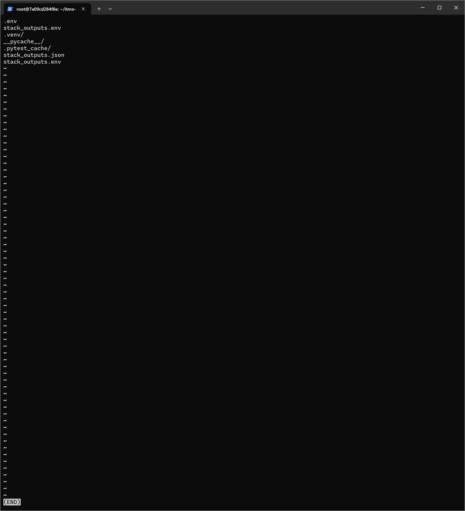
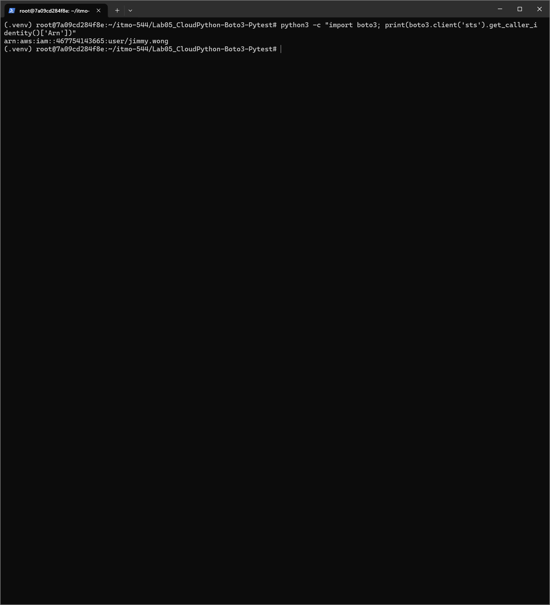
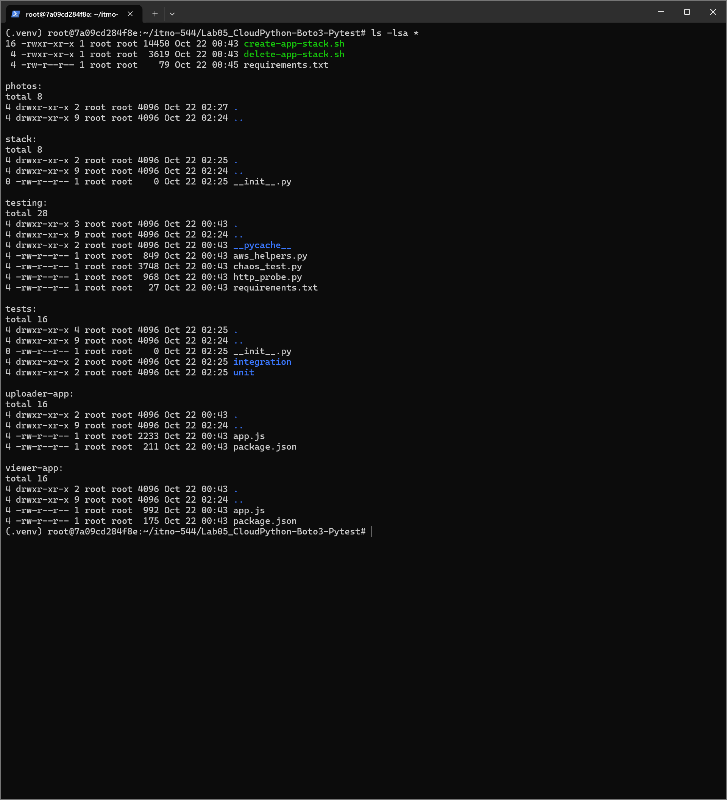
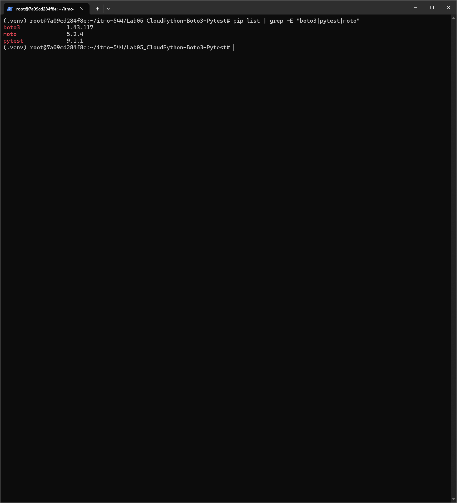

Jimmy Wong\
October 24, 2026\
ITMO-544\
Lab 05 - Infrastructure as Python: From AWS CLI and Bash to boto3 and pytest

# Part 0: Set Up Your Lab05 Folder

# Part A: From AWS CLI to boto3
Question: You can explain why *ignore_errors("NoSuchEntity")* is safer than *2>/dev/null || true*.\
Answer: ?

# Part B: Configuration and Helpers

Above is *python3 -c "from stack.config import Settings; print(Settings.from_file('.env').tiers)"* prints two *Tiers(...)* objects with your real names. If a key is missing, the error lists exactly which ones.

# Part C: Storage and IAM
Question: You can name which *ignore_errors* codes appear in *storage.py* and what each one means.\
Answer: ?

# Part E: Network, Load Balancer, and Auto Scaling
Question: You can point to the line in *ensure_asg* that makes the ASG trust the load balancer's health check, and say why that matters for recovery.\
Answer: ?

# Part F: 

Above is *python3 -m py_compile stack\*.py create_stack.py delete_stack.py* prints nothing. Do not run *create_stack.py* yet. The unit tests come first, and they are free.

# Part G: Unit Tests (No AWS Account Needed)

Above is *pytest* reports 19 passed, and you completed at least one of the "break it on purpose" experiments.

# Part: Integration and Chaos Tests (Against Your Real Stack)

Above shows commands
Question: you can explain why *test_every_target_becomes_healthy* polls with *wait_until* instead of checking once.\
Answer: ?

# Between Part H and I

Above shows folder hierachy.

# Part I: Run It End to End

# Part J: Challenges

