Jimmy Wong\
October 30, 2026\
ITMO-544-01\
Lab 06 - Weather Advisor in the Cloud: Two Tiers, a Free AI Model and a PostgreSQL Database

# Part 0: Set Up Your Lab06 Folder
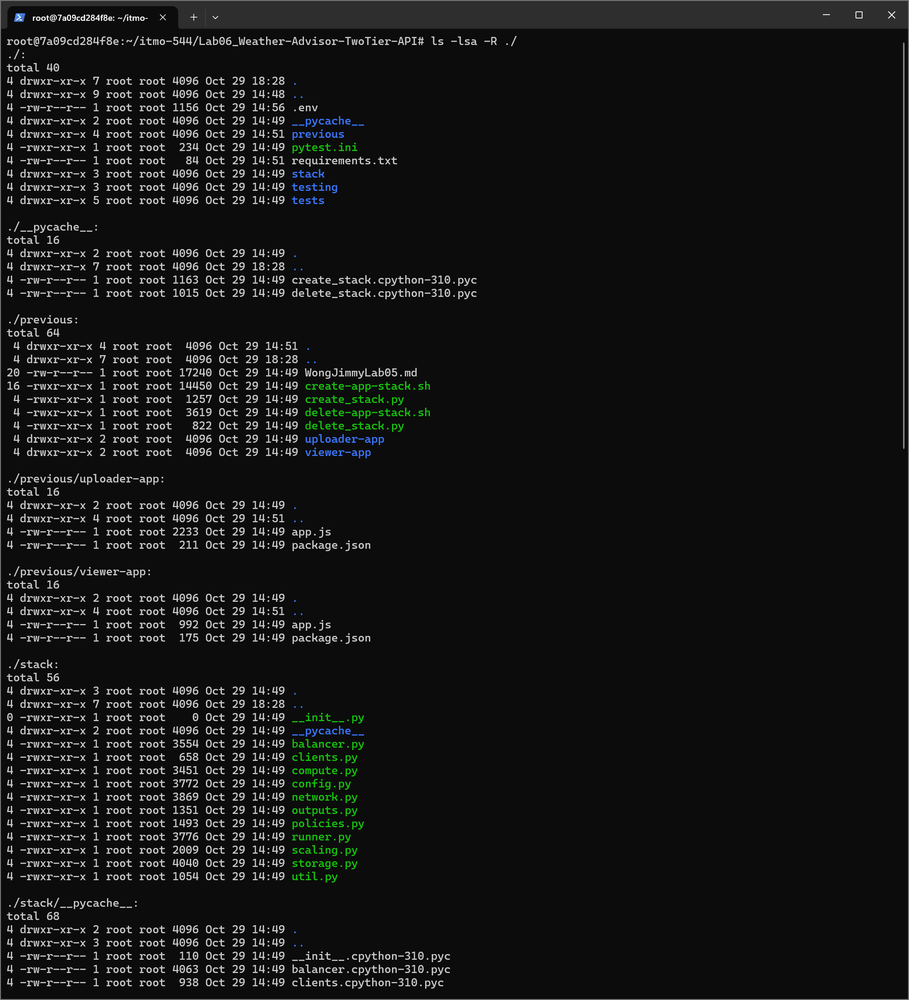
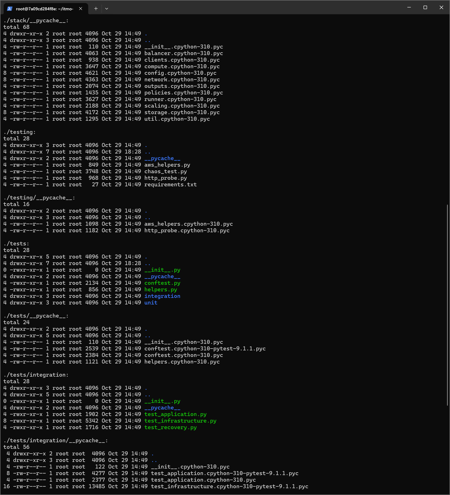
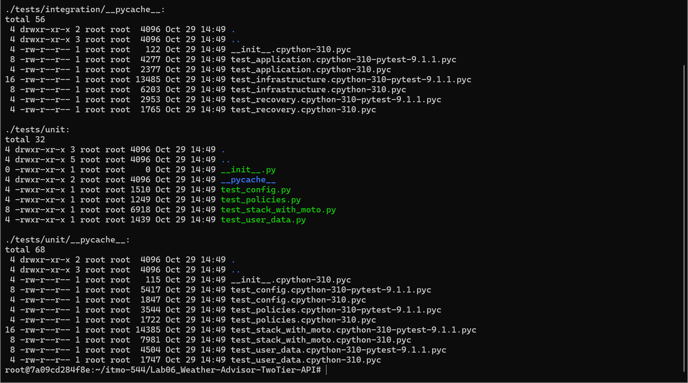
The pictures above show the layout for lab 06 before start working on lab 6 activites below. Check my folder tree at the bottom of this Markdown file.

# Part A: Meet the Two Weather APIs
**Checkpoint:** You can name the two upstream calls the weather service makes for one zip code, and say why one call is not enough.\
Answer: The two upstream calls are **zippopotam.us** API and **National Weather Service (NWS)** API. One call is not enough is because NWS does not accept five-digit U.S. zip codes natively, therefore it requires precise geographic coordinates to figure out which forecast grid points to query.

# Part E: The Database
**Checkpoint:** The script finished and printed the database endpoint. You can explain why *--backup-retention-period 0* turns off, and why that is acceptable here but not for real data.\
Answer: For this lab, we, students, do not need backups and having backups or snapshots would cost AWS credits so it is not worth doing it but it is good practical to understand how important to have backups in real world.

# Part G: Deploy and Test the Application
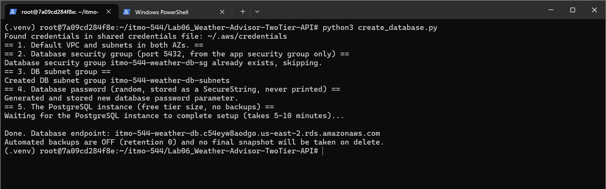 
The picture above shows I executed create_database.py.

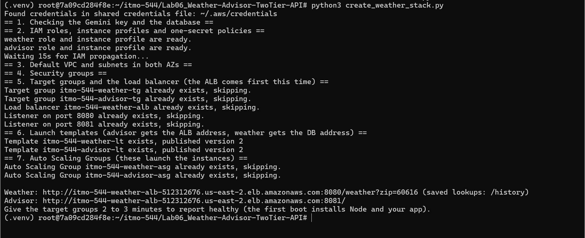 
The picture above shows I executed create_weather_stack.py.

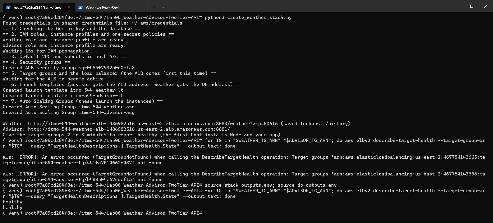
The picture above shows both servers displaying their status as *healthy*.

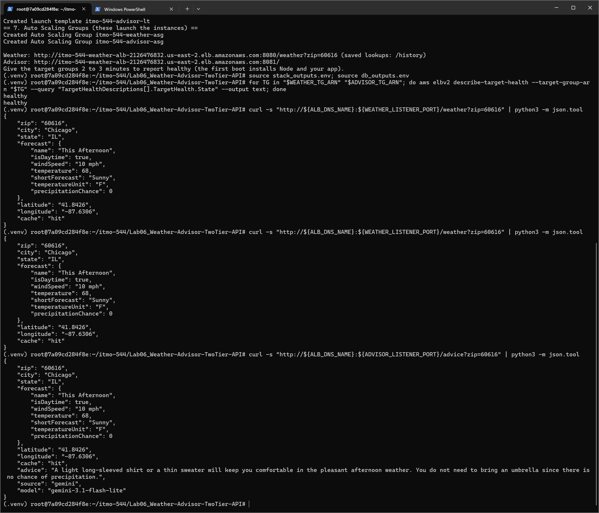 
The picture above shows three command lines so each command line to show what output of zipcode 60616 is.

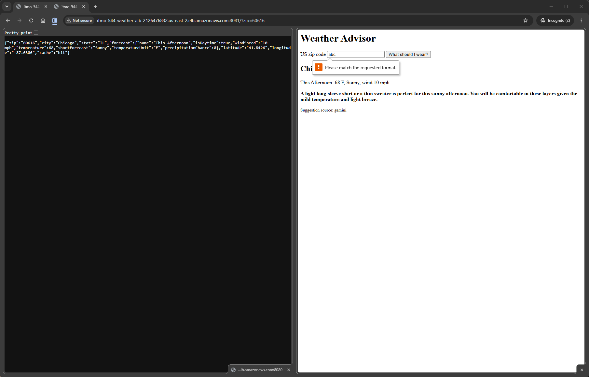 
The picture above shows that the text box displayed a warning to a client that needs to match the zip code which is 5-digit numbered format for a zip code. 

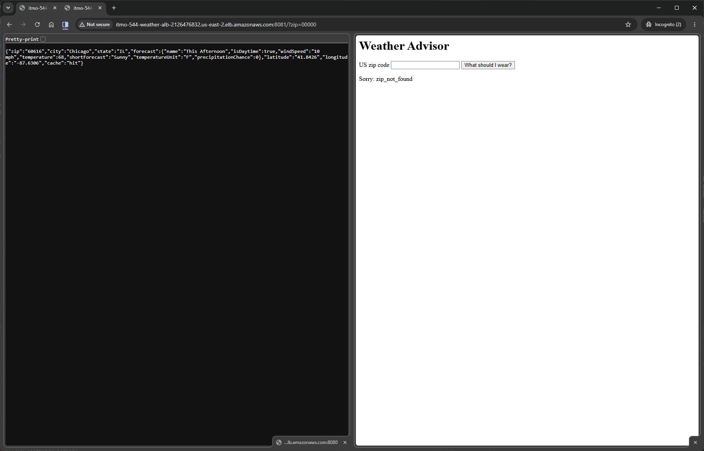 
The picture above shows input zipcode is 00000 and the result is *Sorry: zip_not_found*.

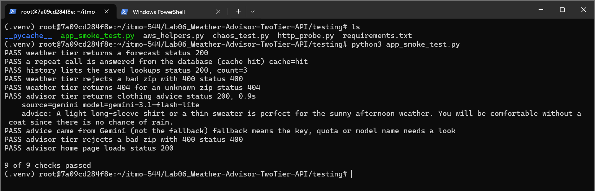 
The picture above shows I executed `app_smoke_test.py`.

# Part H: Experiments
Before doing next steps, ensure you need to do this following commands below:
```
export $(grep -v '^#' .env | xargs); export AWS_DEFAULT_REGION="$AWS_REGION"
source stack_outputs.env; source db_outputs.env
ACCOUNT_ID=$(aws sts get-caller-identity --query Account --output text)

instance_ip() { # usage: instance_ip weather-app or instance_ip advisor-app
    aws ec2 describe-instances \
    --filters "Name=tag:Name,Values=$1" "Name=instance-state-name,Values=running" \
    --query "Reservations[0].Instances[0].PublicIpAddress" --output text
}
```

## Step 1. Read a Service's Log
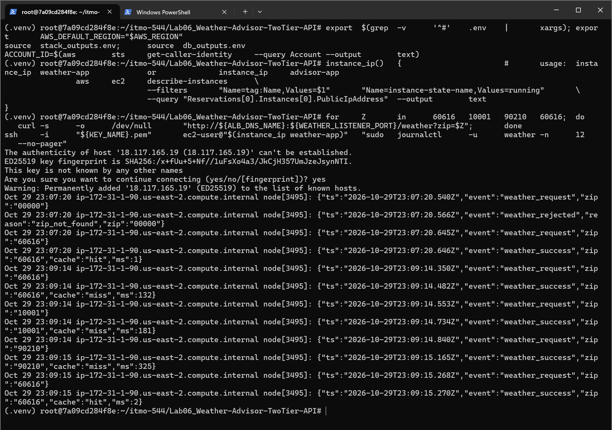 
The picture above shows the command read a service's log.

## Step 2. Look at the stored data
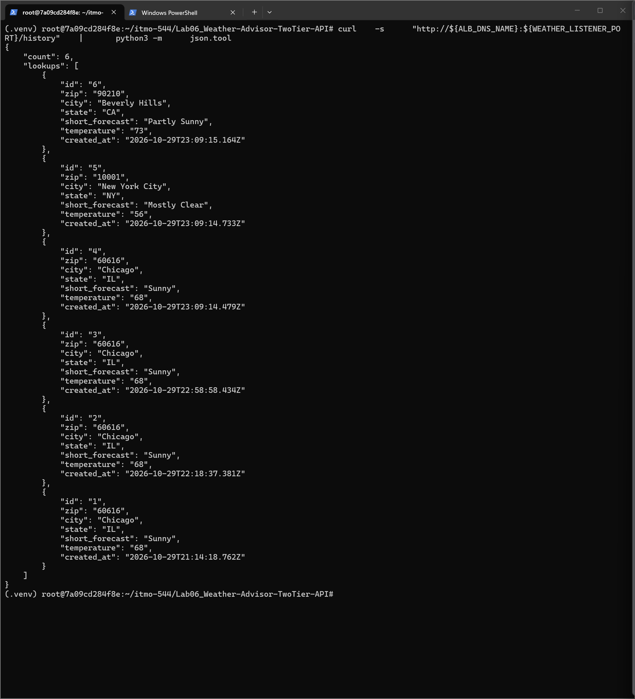 
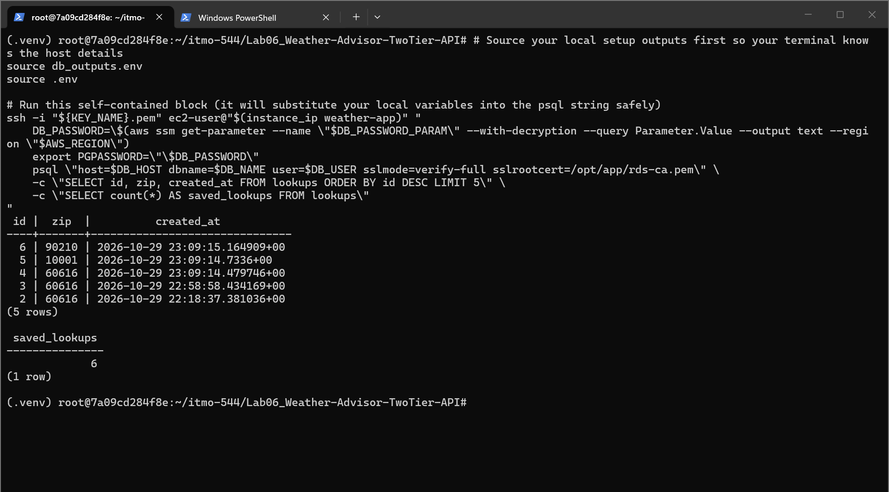 
The pictures above show two different things to look at the stored data. First picture shows human readable. Second picture shows when new data is created and stored in a database for history.

Question: Write down how many rows there are, and why there are fewer rows than requests you made.\
Answer: In the first picture above, there are 6 rows. In the second picture, it shows *5 rows* is because the command asked for `DESC LIMIT 5` to display without taking over the whole screen. 

## Step 3. Prove the cache saves work
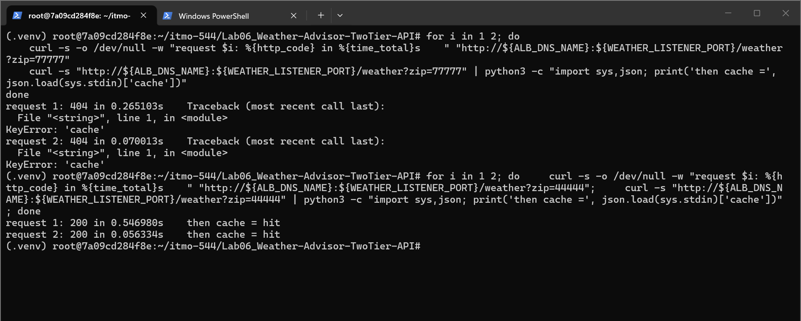 
The picture above shows I chose zip code 77777 to try out.

Question: Write one sentence on why a short ache matters more for a service that calls a rate-limited upstream, and one on why *CACHE_SECONDS* should not be very long for weather.\
Answer: A short cache is critical when calling a rate-limited upstream service (like the Gemini API free tier) because caching deduplicates redundant burst requests, protecting your limited quota from exhausting instantly. Conversely, *CACHE_SECONDS* should not be too long for a weather app because meteorological conditions change dynamically, and an execessive cache window would force users to see stale, outdated forecasts.

## Step 4. Prove the database has no backups and no public address
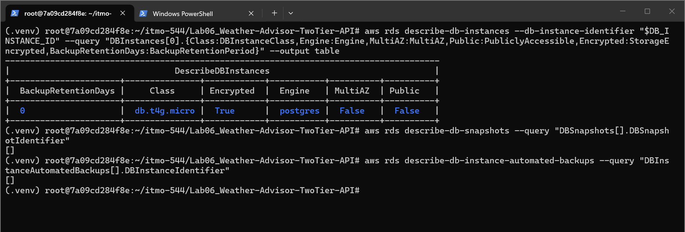 
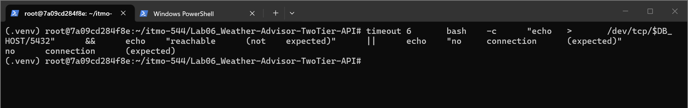 
The pictures above show I executed four command lines to display outputs of no backups/snapshots, and no public address.

## Step 5. Who can read which secret? (least privilege, proved)
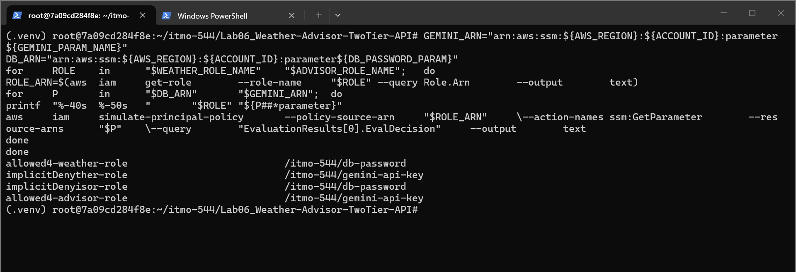 
The picture above shows which role is allowed to do or not allowed to do.

Question: Write one sentence on what an attacker who takes over the advisor tier gets, and what they do not get.\
Answer: An attacker who takes over the advisor tier gains an access to the cached Google Gemini API key. An attacker do not have access (is because of least-privilege IAM instance profile) to the PostgreSQL database password or any customer lookup history cached in the data tier.

## Step 6. Prove the instances are reachable only through the load balancer
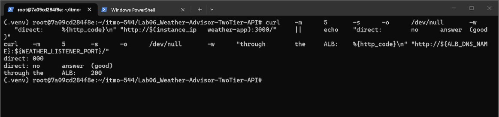 
The picture above shows instances are reachable only through the load balancer.

Question: Explain in one sentence what a security group rule that names another **security group** as its source does that a CIDR range cannot.\
Answer: A rule pointing to a source security group dynamically permits traffic from any EC2 instances belonging to that specific group reguardless of their individual changing IP addresses.

## Step 7. Cut the weather service off from its database
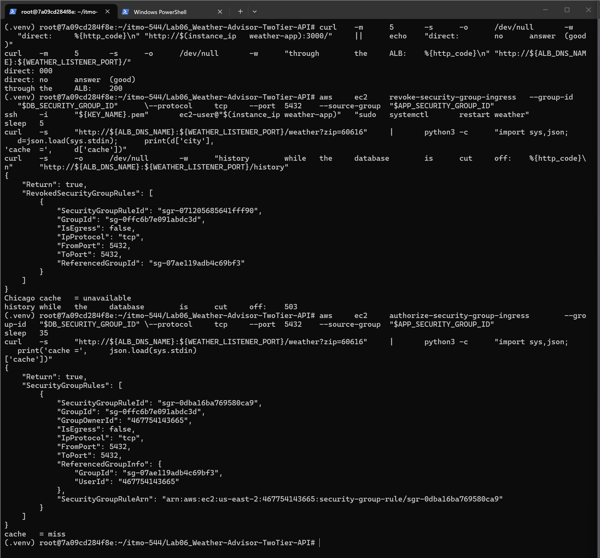 
The picture above shows to cut the weather service off from its database.

Question: Write down why the 30 second pause exists, and what would happen to every request without it while the database is down.\
Answer: The 30 second pause acts as a circuit breaker so that if the database crashes, incoming weather requests do not hang waiting for a 3 second database connection timeout over and over. Without this pause, every single user request would experience severe performance degradation or time out entirely, converting a background cache failure into a severe, application-wide weather outage.

## Step 8. Break the Gemini key and watch the fallback
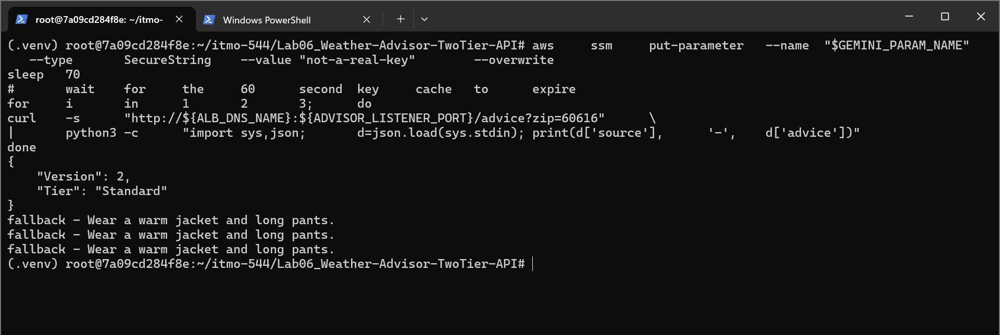 
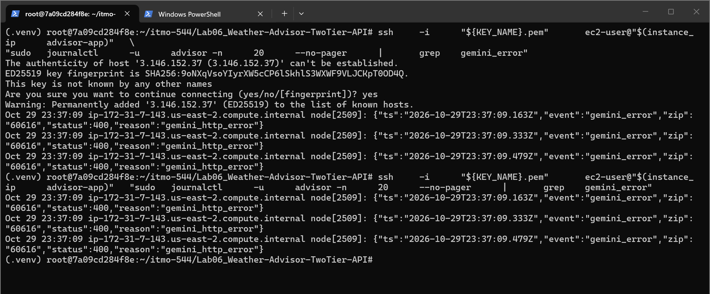 
The pictures above show breaking the gemini key then restore the gemini key.

Question: Write down one problem with a design where users never see an error and the only evidence is a log line that nobody reads.\
Answer: The major problem is that critical system regressions such as expired API keys, billing failures, etc, go completely unnoticed by operations teams until a human manually audits the system, leaving the application running in a permanetly degraded fallback mode without triggering automated alerts.

## Step 9. Fail the weather tier and time the recovery
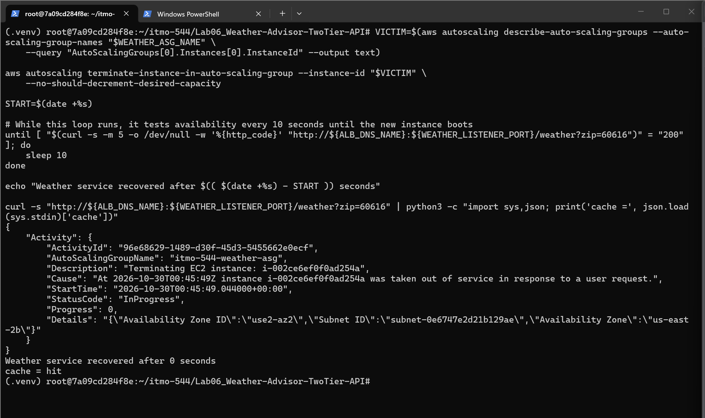 
The picture above shows the weather instance fail or being unhealthy so ASG sends a replacement for weather app.

Question: Write down what that tells you about where state should live in a stack where instances are replaced.\
Answer: This proves that infrastructure instances must remain completely stateless, meaning all persistent state (such as cache entries and history) should live exclusively in a separate, decoupled, centralized data layer like Amazon RDS. This ensures that when individual compute instances are unexpectedly terminated and recreated by an ASG, no user history is lost and the system recovers instantly.

## Step 10. Clean up: stack first, then the database
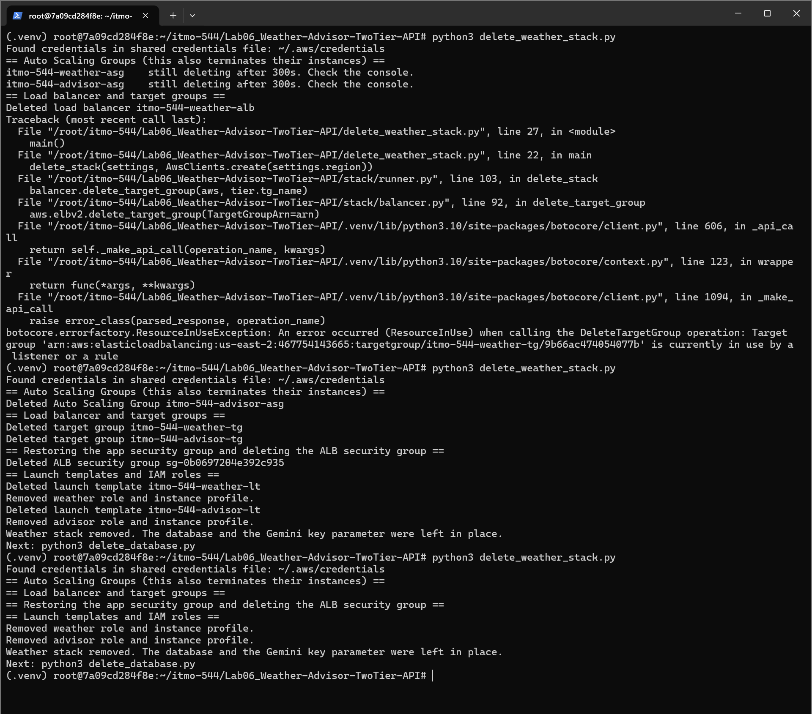 
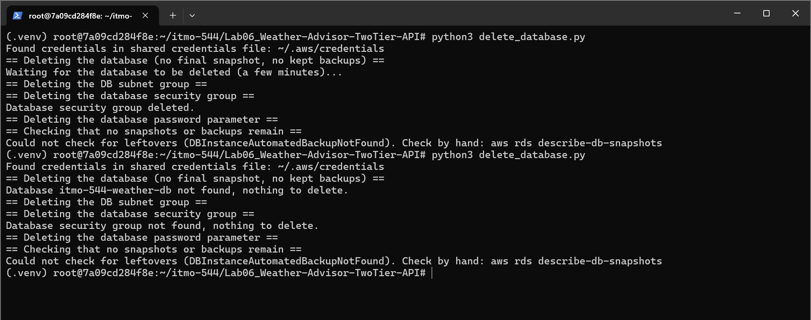 
The pictures above show both scripts are executed twice to ensure nothing is left behind. 

# 15. Security and Privacy Review, aand Troubleshooting
## 15.1 Review Questions
1. Where else could each leak from (shell history, process lists, logs, screenshots, Git)?
  - Hardcoded secrets can leak via Git commits if mistakenly pushed. Setting secrets as plaintext environment variables can leak via shell history (`~/.bash_history`), system logs (if variables are printed during startup crashes), process lists (e.g., viewing `ps aux` while an explicit password is passed to a CLI wrapper), or accidental video recordings and screenshots.
2. What would change if both roles had ssm:* on *?
  - It would break the security principle of least privilege. If an attacker compromised the public-facing advisor tier, they could use the broad permissions to read the weather tier's database password, completely collapsing the security boundary between the application layers.
3. Why is the ALB open to the internet but the instances and the database are not?
  - The ALB acts as the single, hardened reverse-proxy entry point designed to handle public traffic safely. Isolating the EC2 app instances and the RDS database in private subnets without public IP addresses protects them from direct network scans, brute-force exploits, and unauthorized internet attacks.
4. What can an advisor instance do that it should not be able to do? How would you fix it?
  - Because both tiers share the same `APP_SECURITY_GROUP_ID`, an advisor instance can directly establish network connections to the PostgreSQL database port (5432). To fix this, you should create separate security groups: an advisor-sg and a distinct weather-sg, configuring the database rule to strictly accept port 5432 traffic from the weather-sg only.
5. What would you create instead, and which privileges would it need (think: only lookups, only SELECT and INSERT)?
  - Instead of using the administrative master user (weatherapp), you should create a restricted, low-privilege database user profile. It should be granted explicit, scoped permissions strictly limited to running SELECT and INSERT on the lookups table, denying any global structural commands like DROP TABLE or ALTER.
6. What does the certificate check protect against that TLS without it does not?
  - TLS encryption alone protects data from passive wiretapping. Validating the certificate authority chain bundle (rds-ca.pem) guarantees identity protection—ensuring the application is securely routing data to the authentic, legitimate AWS RDS cluster and actively preventing Man-in-the-Middle (MitM) proxy attacks.
7. Show one line of the app and say what would go wrong if it built SQL by joining strings
  - Vulnerable code snippet example: `pool.query("SELECT * FROM lookups WHERE zip = '" + userInput + "'")`. If built by joining strings directly, an attacker could supply a payload like 60616'; DROP TABLE lookups;--, which alters the query structure to maliciously wipe the entire database table.
8. What would you lose if this database held real data, and what would you configure instead?
  - With retention set to 0, you lose the ability to recover from accidental deletions, file corruption, or logical human errors. For a real production app, you would configure a backup retention window of at least 7 to 30 days to capture automated daily snapshot baselines and leverage write-ahead transaction logs for Point-in-Time Recovery (PITR).
9. Who decides when stored data may be destroyed in a real organization?
  - In an enterprise setting, data lifecycle destruction schedules are governed cooperatively by the organization's Data Protection Officers (DPO), compliance management, and legal counsel based on regional laws (e.g., GDPR right-to-be-forgotten, HIPAA, or corporate data retention mandates).
10. What could an attacker gain if the page printed raw model output?
  - If raw output is left unescaped, an attacker could pull off a Prompt Injection attack, forcing the AI model to output malicious scripts (`<script>stealSessionCookies()</script>`). This introduces a severe Cross-Site Scripting (XSS) vulnerability that can compromise the browser sessions of any users viewing the advisor webpage.
11. What would you have to change before using a paid or school-owned Gemini account for real users?
  - You would need to sign a formal business data protection contract (such as a Data Processing Addendum) ensuring Google does not log, store, or train its public AI foundation models on your proprietary prompt history or user inputs.
12. How could someone use up your quota, and what could you add (rate limiting, a WAF, authentication)?
  - A bad actor could write a basic loop script hitting your public web port with thousands of automated requests, completely consuming your daily Gemini API allocation. To mitigate this, you could deploy an AWS WAF to block malicious bots, enforce application-tier rate limiting rules via Express, or mandate user authentication (OAuth/Cognito).
13. Why is it important that the response says source: fallback or cache: unavailable?
  - Explicit tracking keys allow monitoring software and engineering teams to cleanly isolate downstream architectural dependencies. It alerts operators immediately when components are failing behind the scenes without breaking the user experience entirely.

## 15.2: Troubleshooting
URL: Go to this [page for troubleshooting](troubleshooting/README.md) to see a list of troubleshoots I've been through.

# 16. Submission Checklists
*NOTES: Graduate Students, skip 16.1. Everyone (ITMO 444 and ITMO 544)*
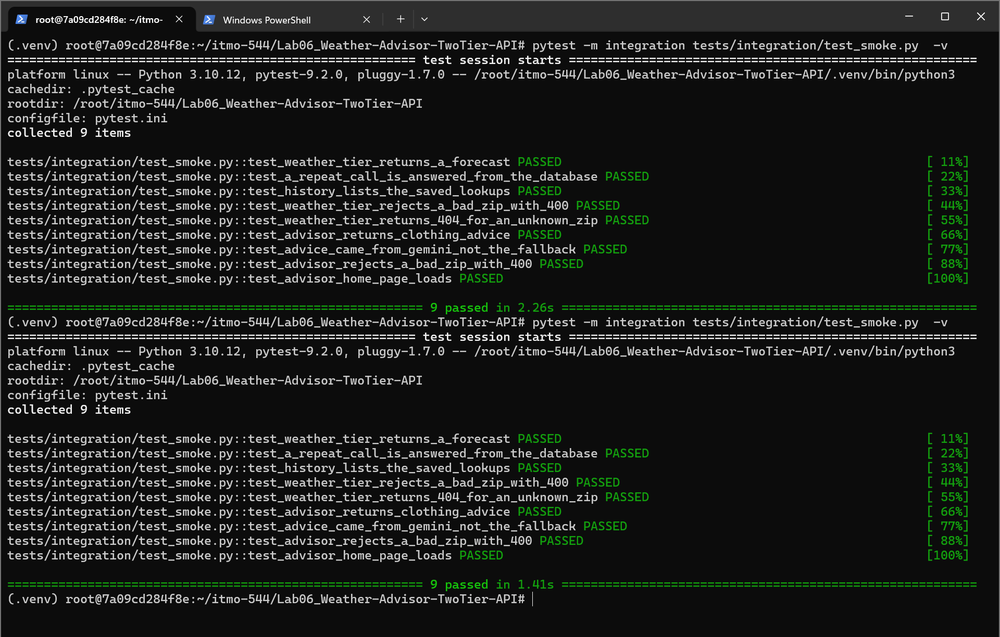 
The picture above shows I executed `test_smoke.py` and got all 9 passed as result.

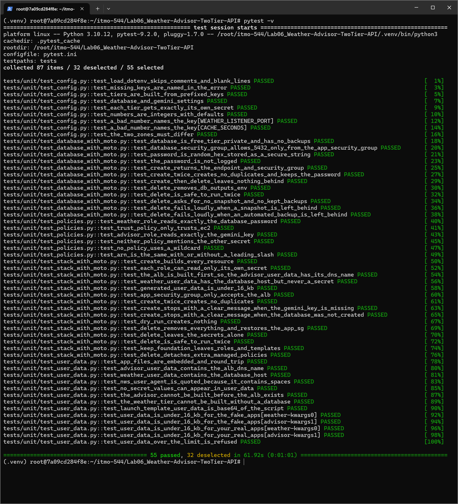
The picture above shows I executed `pytest -v` and got 55 passed which is a big number!

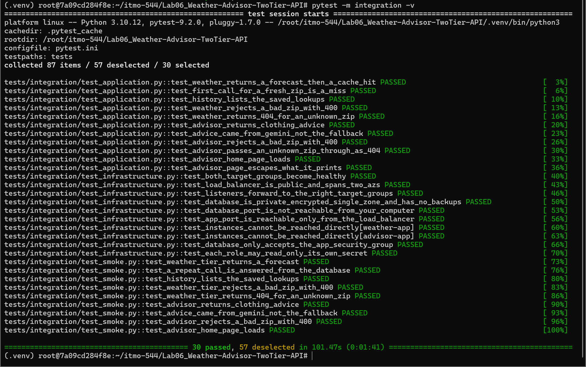
The picture above shows I executed `pytest -m integration -v` and got 30 passed. 

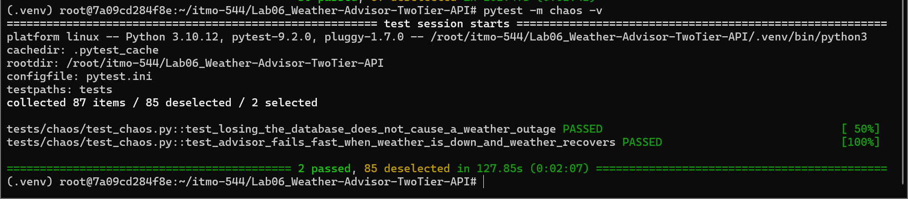
The picture above shows I executed `pytest -m chaos -v` and got 2 passed.

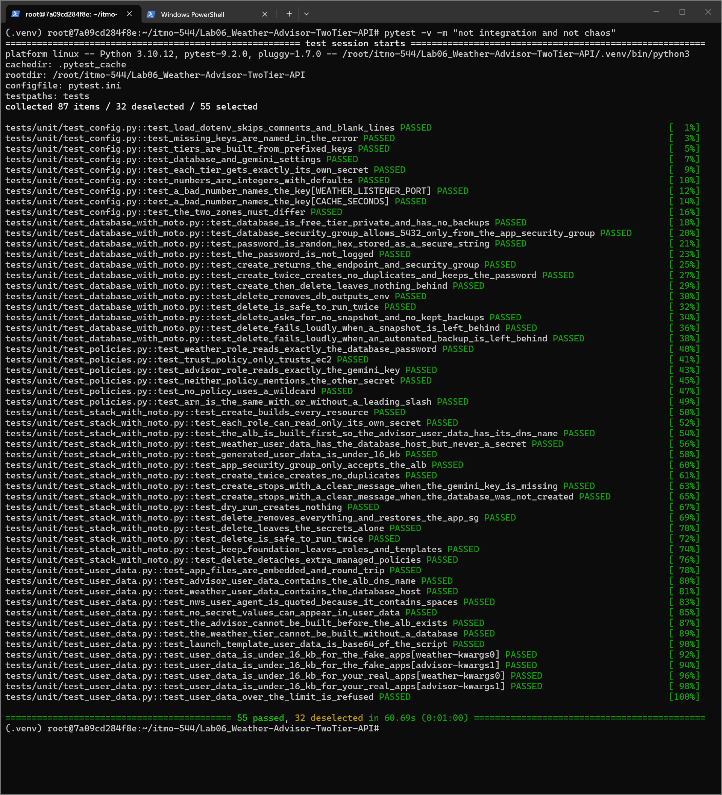
The picture above shows I executed `pytest -v -m "not integration and not chaos"` and got 55 passed. 

## 16.2. Graduate Students Only (ITMO 544)
### Short Answers
Question: Half a page: what moto could not prove for you in this lab (think: real backups, real network reachability, TLS), and which integration test covers each gap.\
Answer: The mock library moto simulates the surface area of AWS API responses locally but cannot replicate real physical cloud behavior, network structure, or third-party interactions.
1. Real Network Reachability and Security Group Constraints
  - *moto* allows any simulated client to reach any simulated resource without checking security groups. It cannot prove that the database port is strictly blocked from your local computer or that the application instances accept traffic only through the ALB. 
  - Integration Test covers this: checking the database port is unreachable from your computer and that instances are reachable exclusively through the ALB.
  - `test_database_port_is_not_reachable_from_your_computer`,
  - `test_app_port_is_reachable_only_from_the_load_balancer`,
  - `test_instances_cannot_be_reached_directly`
2. Actual AWS Free-Tier Configurations and Backups
  - *moto* silently accepts parameter mock setups without enforcing real-world constraints like true multi-AZ cost impacts or whether automated backup files are being generated on AWS.
  - Integration Test covers this: checking the real-world AWS instance parameters via *describe_db_instances* during deployment to verify *BackupRetentionPeriod=0* and *PubliclyAccessible=false* are operating properly in production.
  - `test_database_is_private_encrypted_single_zone_and_has_no_backups`
3. Upstream API Dependencies and Chaos Failures
  - *moto* cannot simulate live latency, rate limits, or regional outages from the NWS API, the zip lookup API, or the Gemini API.
  - Integration Test covers this: whichever forces connection terminations (revoking security group rules or terminating instances) to verify the fallback system functions under real network stress.
  - `test_losing_the_database_does_not_cause_a_weather_outage` (database rule revoked),
  - `test_advisor_fails_fast_when_weather_is_down_and_weather_recovers` (weather instance terminated),
  - and `test_advice_came_from_gemini_not_the_fallback` (a real Gemini call)
4. TLS Certificate Verification
  - *moto* never opens a real database connection, so it cannot show that the weather app encrypts the connection or checks the server certificate against the RDS CA bundle (`/opt/app/rds-ca.pem`, downloaded at boot).
  - Integration test that covers this: If the certificate check failed, the app could not connect and the answer would be `cache: unavailable`, never `hit`. This is indirect evidence. It proves the verified connection works, not that an unverified one would be refused.
  - `test_a_repeat_call_is_answered_from_the_database`,
  - `test_weather_returns_a_forecast_then_a_cache_hit`

Question: One paragraph comparing the Python and bash versions of the same step (for example creating the database and waiting for it): what was easier to get right, and what was easier to test.\
Answer: Creating the database and waiting for it was easier to get right in Python. In bash, I checked whether the instance existed with `describe-db-instances ... >/dev/null 2>&1`, which hides every failure, including a typo or a permission error. In Python, I catch the one expected error code (`DBInstanceNotFound`) and let everything else stop the script. The password came from `secrets.token_hex(16)` and went only to SSM and the create call, and `get_waiter("db_instance_available").wait(...)` replaced the CLI wait. Python was also much easier to test. With *moto*, the same functions ran in seconds with no AWS account, so I could check the instance class, the zero backup retention, the privacy setting and the security group rule, and prove that running create twice makes no duplicates. A bash script can only be tested by running it against real AWS. The cost was that *moto* does not behave exactly like AWS, which is why some bugs only showed up in the integration run, such as real AWS raising `DBInstanceAutomatedBackupNotFound` instead of returning an empty list.

# Lab 06 Layout
```
📦 Lab06_
├─ previous/
│  ├─ uploader-app/
│  │  ├─ app.js
│  │  └─ package.json
│  ├─ viewer-app/
│  │  ├─ app.js
│  │  └─ package.json
│  ├─ create-app-stack.sh
│  ├─ create_stack.py
│  ├─ delete-app-stack.sh
│  ├─ delete_stack.py
│  └─ test_recovery.py
├─ advisor-app/
│  ├─ app.js
│  └─ package.json
├─ weather-app/
│  ├─ app.js
│  └─ package.json
├─ testing/
│  ├─ app_smoke_test.py
│  ├─ aws_helpers.py
│  ├─ chaos_test.py
│  ├─ http_probe.py
│  └─ requirements.txt
├─ stack/
│  ├─ balancer.py
│  ├─ clients.py
│  ├─ compute.py
│  ├─ config.py
│  ├─ database.py
│  ├─ network.py
│  ├─ outputs.py
│  ├─ policies.py
│  ├─ runner.py
│  ├─ scaling.py
│  ├─ storage.py
│  └─ util.py
├─ tests/
│  ├─ chaos/
│  │  └─ test_chaos.py
│  ├─ integration/
│  │  ├─ test_application.py
│  │  ├─ test_infrastructure.py
│  │  └─ test_smoke.py
│  ├─ unit/
│  │  ├─ conftest.py
│  │  ├─ test_config.py
│  │  ├─ test_database_with_moto.py
│  │  ├─ test_policies.py
│  │  ├─ test_stack_with_moto.py
│  │  └─ test_user_data.py
│  ├─ conftest.py
│  └─ helpers.py
├─ .env
├─ .gitignore
├─ create_database.py
├─ create_weather_stack.py
├─ delete_database.py
├─ delete_weather_stack.py
├─ pytest.ini
└─ requirements.txt
```
©generated by [Project Tree Generator](https://woochanleee.github.io/project-tree-generator)