# Troubleshooting and Solutions
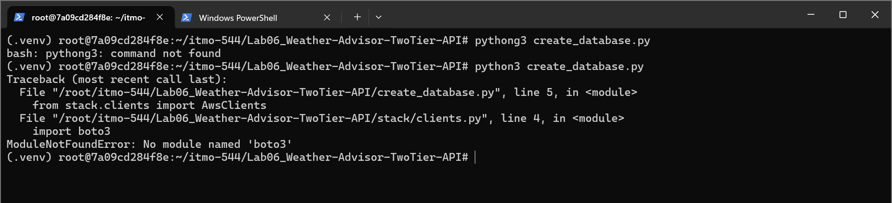
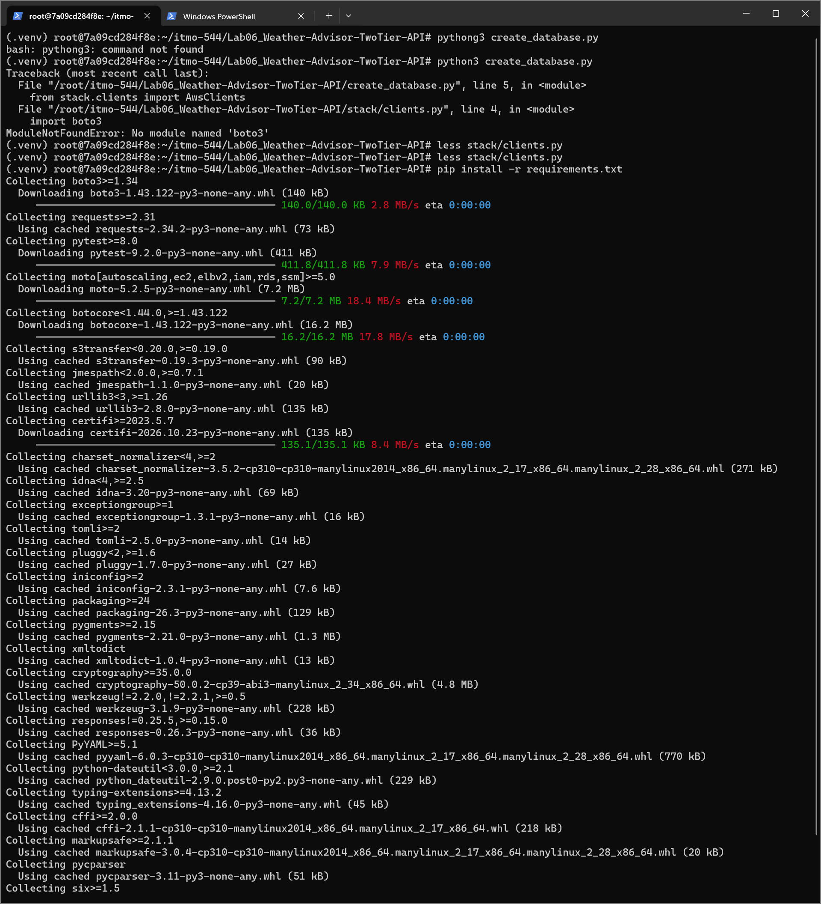
The pictures above show missing requirements via pip so I had to install in the lab 06.

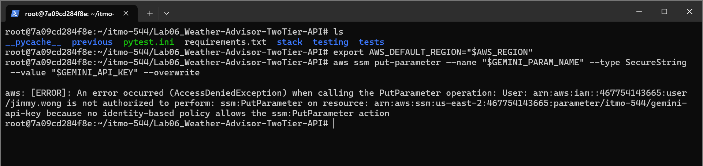
The picture above shows that IAM role got denied to do a `ssm:PutParameter` action. Solution is to add this specific permission to the IAM Role.

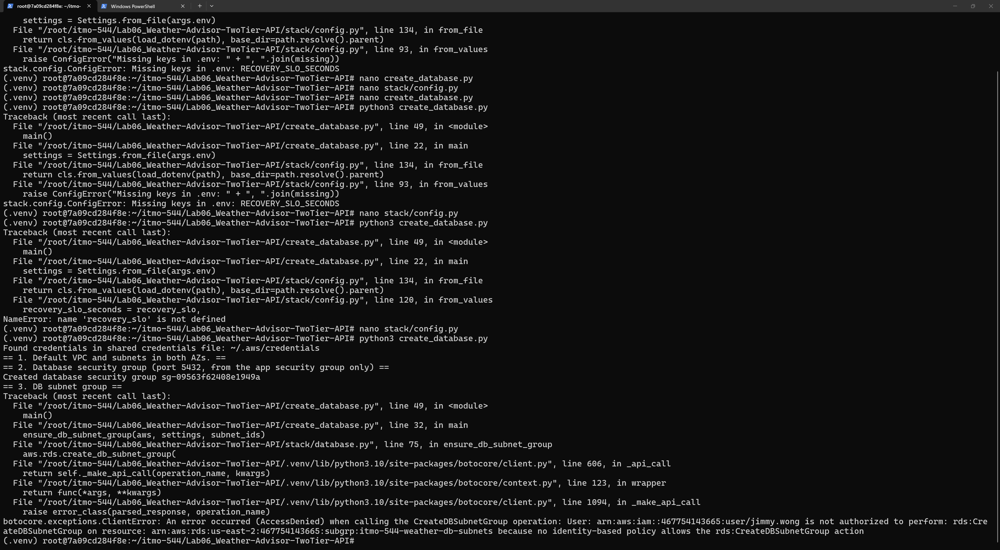
The picture above shows that IAM role got denied to do a `rds:CreateDBSubnetGroup` action. Solution is to add this specific permission to the IAM Role.

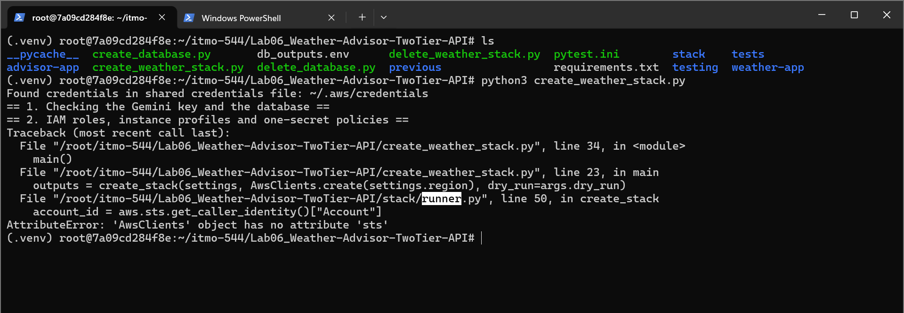
The picture above shows that my clients.py forgot to include `sts: Object` and `sts=session.client("sts")`.

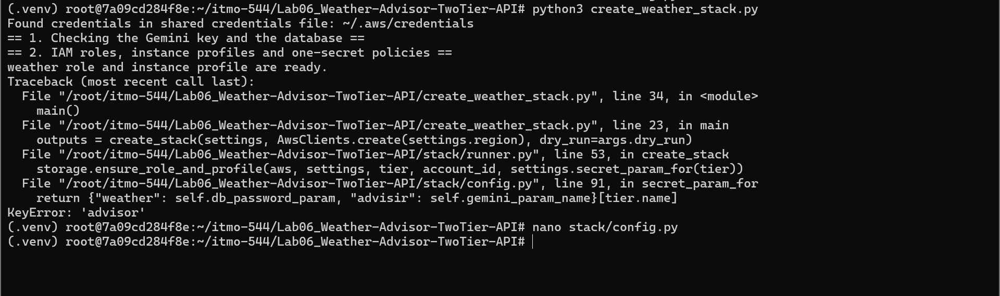
The picture above shows I made a typo in create_weather_stack.py. I fixed that typo from *advisir* to *advisor*.

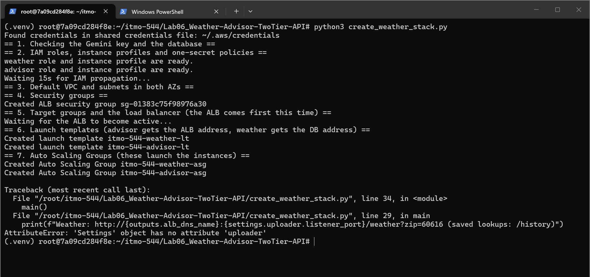
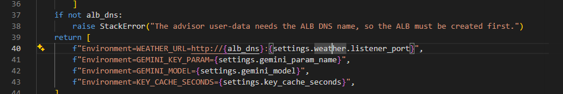
The pictures above show that I didn't change the role or overlooked the role. I changed from *uploader* to *weather*.

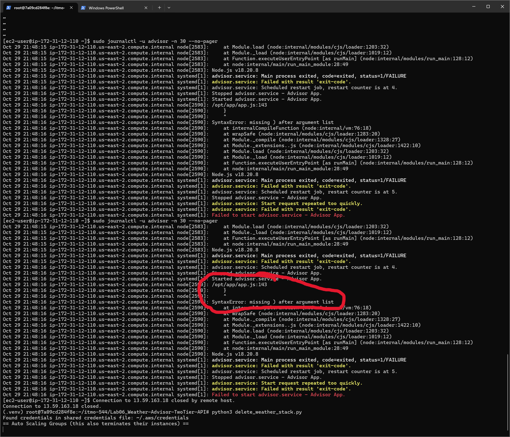
The picture above shows that python detected tabs and spacings misaligned IN the advisor instance via SSH. 

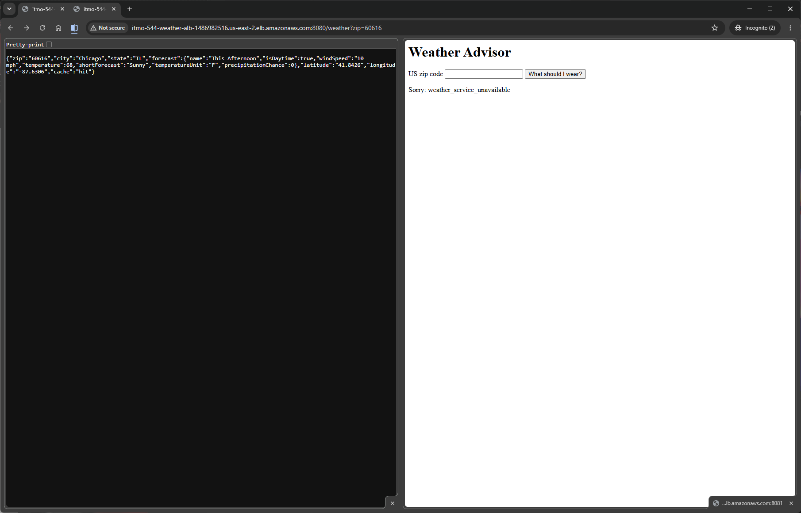
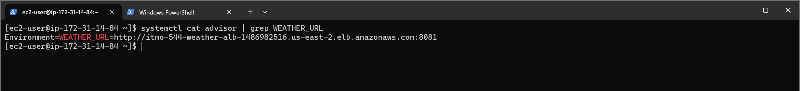
The pictures above show that the port is wrong. This got discovered in the advisor instance via SSH to `grep` the *WEATHER_URL* to see if the port is right or wrong.

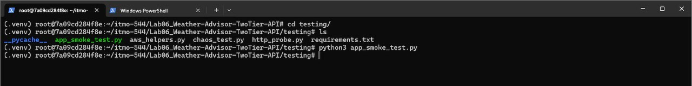
The picture above shows that the python printing blank results. I had to troubleshoot through the python file and discovered misaligned tabs or spacings.

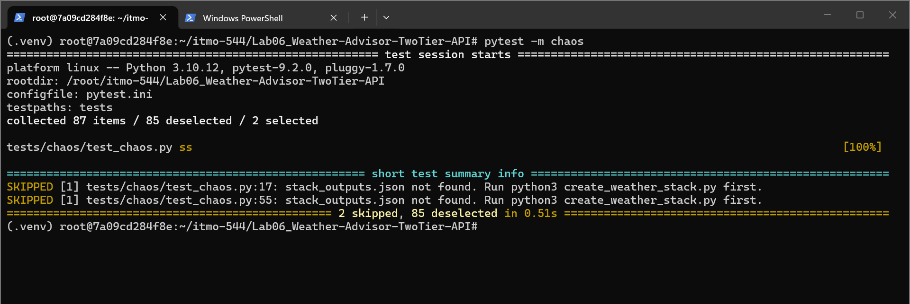
The picture above shows obvious answer that I needed to execute the *create_weather_stack.py*.

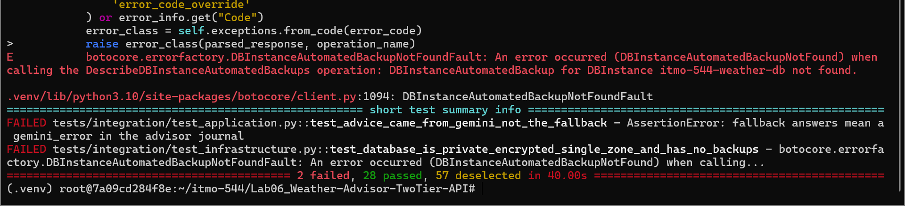
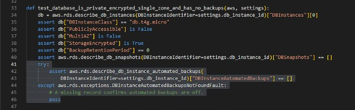
The pictures above show that I didn't include try-except statement for `DBInstanceAutomatedBackupNotFound`. 

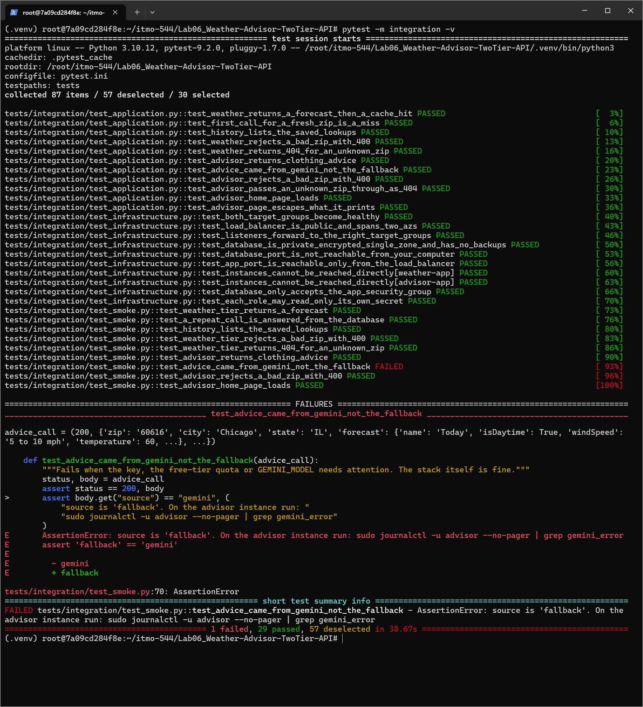
The pictures above show that timeout failed while running `pytest -m integration -v`. I decided to wait for a bit before I ran again starting from: `test_smoke.py` -> `pytest -v` -> `pytest -m integration -v` -> `pytest -m chaos -v` -> `pytest -v -m "not integration and not chaos"`. After executing those pytests and test_smoke.py, the results are showing all passes without a single failure.