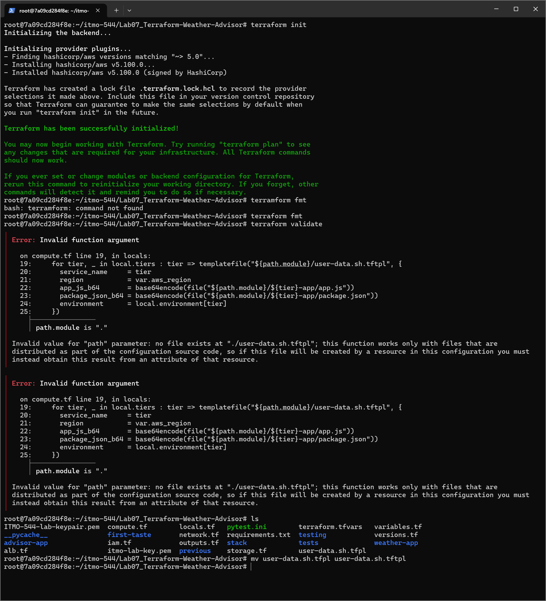
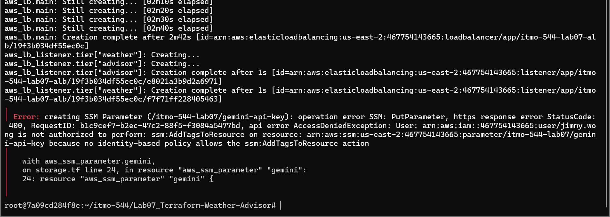
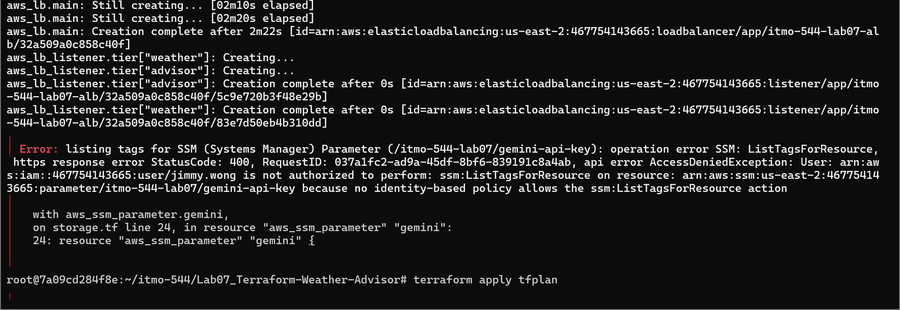
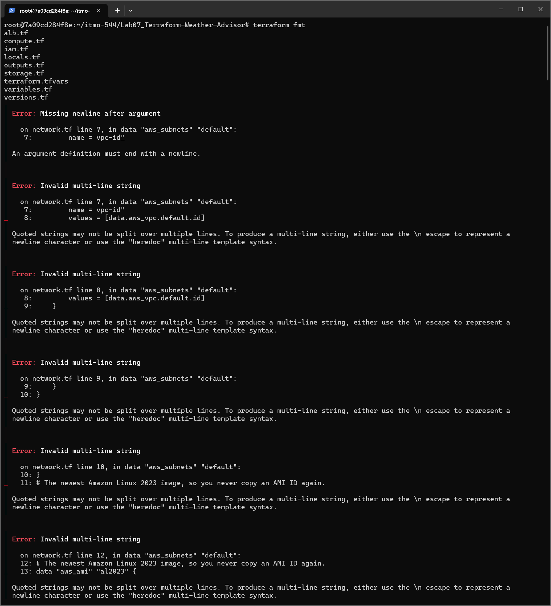
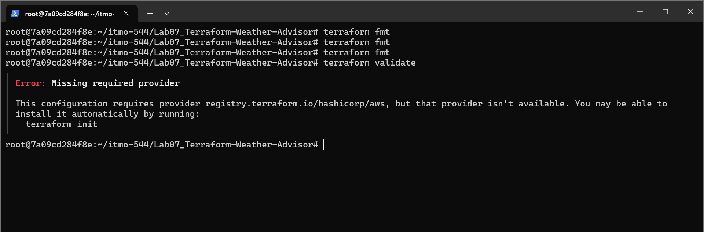

# Troubleshooting and Solutions

The picture above shows that I made a typo while naming the file, `user-data.sh.tfpl` --> `user-data.sh.tftpl`.

The picture above shows that the IAM user is denied to do this permission: `ssm:AddTagsToResource`.

The picture above shows that the IAM user is denied to do this permission: `ssm:ListTagsForResource`.

The picture above shows the `terraform fmt` discovered a list of errors being displayed in the picture. I noticed I was missing a double-quote in the first error. So I fixed it and all of errors in the picture went clear.

The picture above shows the error is telling me it is missing the required provider which is `terraform init` so I went to execute the command, `terraform init`.